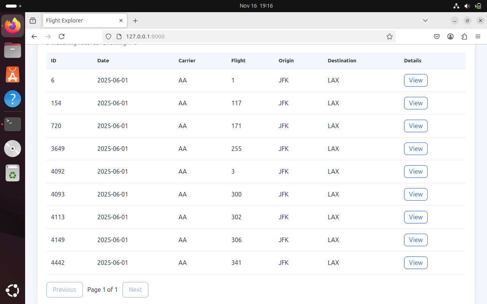

# Flight API Quality Lab

A flight exploration application and software testing portfolio project built with Python, FastAPI and PostgreSQL.

The application combines a browser interface, a REST API and historical flight records imported from the U.S. Bureau of Transportation Statistics (BTS). It demonstrates database integration, input validation, repeatable data imports, API testing, browser automation and continuous integration.

This is an educational project, not a live flight tracker or booking service.

## Application preview

### Flight search


### Search results



### Flight details


## Features

- Browse flight records in a web interface.
- Filter by origin, destination, flight date and carrier.
- Sort results and navigate between pages.
- Open individual flight details.
- Create demonstration records through the API.
- Validate request data with Pydantic and database constraints.
- Import historical BTS data from CSV.
- Skip previously imported records using a unique database index.
- Check API availability and database readiness.
- Run API integration tests against a separate PostgreSQL database.
- Run browser tests with Playwright.
- Build and test the Docker image in GitHub Actions.
- Save JUnit reports, application logs and browser failure traces.

## Technologies

| Area | Technologies |
|---|---|
| Backend | Python 3.13, FastAPI, Pydantic |
| Database | PostgreSQL 17, Psycopg, SQL |
| Frontend | HTML, CSS, JavaScript |
| API testing | pytest, FastAPI TestClient |
| Browser testing | Playwright, pytest-playwright, Chromium |
| Manual testing | Postman |
| Containers | Docker, Docker Compose |
| CI | GitHub Actions |
| Version control | Git, GitHub |

## Architecture

```text
Browser / Postman / HTTP client
              |
              | localhost:8000
              v
      FastAPI application
      + Flight Explorer UI
              |
              | db:5432
              v
         PostgreSQL
              |
              v
      Persistent Docker volume
```

The API and frontend are served by the same application.

The CSV importer runs separately and writes records to PostgreSQL.
The application does not download BTS data automatically.

## Historical dataset

Source: U.S. Bureau of Transportation Statistics,
[Reporting Carrier On-Time Performance](https://www.transtats.bts.gov/TableInfo.asp?QO_fu146_anzr=b0-gvzr&gnoyr_VQ=FGJ).

The dataset contains historical reports for domestic flights operated by reporting carriers.

The locally verified June 2025 import contained:

| Metric | Result |
|---|---:|
| Imported historical records | 611,575 |
| First flight date | 2025-06-01 |
| Last flight date | 2025-06-30 |
| Distinct carrier codes | 14 |
| Rejected rows in the completed import | 0 |

These figures describe the dataset used during development.
A fresh installation starts with an empty application database.
Manually created demonstration records may increase the total row count.

The importer currently stores:

- Flight date
- Carrier code
- Flight number
- Origin airport code
- Destination airport code

Departure times, delays, cancellations and diversions are not currently
stored by the importer, even if present in the downloaded CSV.

Raw data is excluded from Git and the Docker build context.

### Duplicate handling

Imported records are identified by:

```text
flight_date + carrier_code + flight_number + origin + destination
```

A partial unique index applies when both flight date and carrier code are present.

The importer uses `ON CONFLICT ... DO NOTHING`, allowing the same file
to be imported again without duplicating matching records.

Demonstration records without a date or carrier are outside this uniqueness rule.

## First-time setup

The following commands are intended for Linux.
When using VirtualBox, run them inside the Ubuntu VM.

Requirements:

- Git
- Docker Engine and Docker Compose
- Python 3.13 with pip and venv support
- Internet access for dependencies and optional dataset download

If required by your Docker installation, prefix Docker commands with `sudo`.

### 1. Clone the repository

```bash
git clone https://github.com/suchR3K/flight-api-quality-lab.git
cd flight-api-quality-lab
```

Run subsequent commands from this directory.

### 2. Configure environment variables

```bash
cp .env.example .env
```

Edit `.env`:

```dotenv
POSTGRES_HOST=127.0.0.1
POSTGRES_PORT=5432
POSTGRES_DB=flight_lab
POSTGRES_USER=flight_app
POSTGRES_PASSWORD=replace_with_your_local_password
```

Choose your password before initializing PostgreSQL.
Do not commit `.env`.

For an existing installation, keep the working configuration.
Changing `.env` does not change the password of an existing PostgreSQL user.

### 3. Prepare the Python environment

```bash
python3.13 -m venv .venv
source .venv/bin/activate
python -m pip install -r requirements.txt
```

### 4. Start PostgreSQL

```bash
docker compose up -d db
docker compose ps
```

Wait until PostgreSQL reports `healthy`.

### 5. Initialize the application schema

Run these commands once, against a new application database:

```bash
docker compose exec -T db psql -U flight_app -d flight_lab -v ON_ERROR_STOP=1 < sql/001_create_flights.sql

docker compose exec -T db psql -U flight_app -d flight_lab -v ON_ERROR_STOP=1 < sql/002_add_flight_details.sql

docker compose exec -T db psql -U flight_app -d flight_lab -v ON_ERROR_STOP=1 < sql/003_add_flight_unique_index.sql
```

The SQL files must run in order.
There is no automatic migration tracking.
Do not rerun already applied migrations.

### 6. Initialize the test database

```bash
docker compose exec -T db createdb -U flight_app flight_lab_test

docker compose exec -T db psql -U flight_app -d flight_lab_test -v ON_ERROR_STOP=1 < sql/001_create_flights.sql

docker compose exec -T db psql -U flight_app -d flight_lab_test -v ON_ERROR_STOP=1 < sql/002_add_flight_details.sql

docker compose exec -T db psql -U flight_app -d flight_lab_test -v ON_ERROR_STOP=1 < sql/003_add_flight_unique_index.sql
```

Run this initialization once per new test database.

- `flight_lab` contains application and imported data.
- `flight_lab_test` is reserved for automated tests.

### 7. Start the application

```bash
docker compose up -d --build api
docker compose ps
```

Open:

- [Flight Explorer](http://127.0.0.1:8000/)
- [Interactive API documentation](http://127.0.0.1:8000/docs)
- [API health](http://127.0.0.1:8000/health)
- [Database readiness](http://127.0.0.1:8000/ready)

When running in a VM, these addresses refer to services inside that VM.

The interface initially shows no records.
Import the historical dataset or create records through the API.

## Import BTS data

Download a CSV export for June 2025 from the
[BTS download page](https://www.transtats.bts.gov/DL_SelectFields.aspx?QO_fu146_anzr=&gnoyr_VQ=FGJ).

Include these required columns:

```text
FL_DATE
OP_UNIQUE_CARRIER
OP_CARRIER_FL_NUM
ORIGIN
DEST
```

The current parser expects dates in this format:

```text
6/1/2025 12:00:00 AM
```

Save the CSV as:

```text
data/raw/bts_flights_2025_06.csv
```

Activate the Python environment and import an initial sample:

```bash
source .venv/bin/activate
python import_bts.py data/raw/bts_flights_2025_06.csv --limit 1000
```

Repeat the command to check duplicate handling.
Previously imported matching records should be reported as skipped.

Import the complete file:

```bash
python import_bts.py data/raw/bts_flights_2025_06.csv --limit 0
```

`--limit 0` means no row limit.

The importer prints the target database and counts of processed,
inserted, skipped and rejected records.

The import uses the application database configured in `.env`.

## API endpoints

| Method | Path | Purpose |
|---|---|---|
| GET | `/` | Flight Explorer interface |
| GET | `/health` | API availability |
| GET | `/ready` | Database and required flight schema readiness |
| GET | `/flights` | Filtered, sorted and paginated records |
| GET | `/flights/{flight_id}` | Individual flight details |
| POST | `/flights` | Create a flight record |

### Search flights

```bash
curl "http://127.0.0.1:8000/flights?origin=JFK&destination=LAX&flight_date=2025-06-01&carrier_code=AA&limit=10&offset=0"
```

Supported query parameters:

| Parameter | Description |
|---|---|
| `origin` | Three-letter uppercase origin code |
| `destination` | Three-letter uppercase destination code |
| `flight_date` | Date in `YYYY-MM-DD` format |
| `carrier_code` | Carrier code |
| `limit` | Page size, from 1 to 100; default 20 |
| `offset` | Number of records to skip; default 0 |
| `sort_by` | `id`, `flight_date`, `carrier_code`, `flight_number`, `origin` or `destination` |
| `sort_order` | `asc` or `desc`; default `asc` |

The response contains `items`, `total`, `limit` and `offset`.

### Create a demonstration record

```bash
curl -X POST http://127.0.0.1:8000/flights \
  -H "Content-Type: application/json" \
  -d '{
    "flight_number": "DEMO123",
    "origin": "WAW",
    "destination": "LHR",
    "flight_date": "2025-06-15",
    "carrier_code": "LO"
  }'
```

A successful request returns HTTP 201 and the created record.
The database generates its ID.

Flight date and carrier code are optional.
Fields with null date or carrier values are omitted from flight responses.

### Validation and errors

- Flight number, origin and destination are required.
- Flight numbers are trimmed and must not be blank.
- Airport codes must contain exactly three uppercase ASCII letters.
- Origin and destination must differ.
- A supplied carrier code must not be blank.
- Dates must be valid.
- Airport codes are checked for format, not against an airport directory.
- Unknown flight IDs return HTTP 404.
- Invalid request data returns HTTP 422.
- Duplicate dated records covered by the unique index return HTTP 409.
- Database errors handled by the application return HTTP 503.

`/health` does not query PostgreSQL.
`/ready` checks database connectivity and the required flight columns.

## Automated testing

### API integration tests

```bash
source .venv/bin/activate
python -m pytest tests/ -v --junitxml=reports/api-junit.xml
```

PostgreSQL must be running and `flight_lab_test` must be initialized.
A running Uvicorn process is not required.

Coverage includes:

- Health responses
- Flight creation and retrieval
- Missing records and invalid input
- Date and carrier validation
- Filtering and pagination
- Sorting and stable page ordering
- Duplicate detection
- Empty search results

Before each test, the database fixture checks the database name,
prepares known records and overrides the API database dependency.

The shared transaction is rolled back after the test.
Tests must not explicitly commit this shared connection.

The fixture is designed for sequential execution.
Do not run these tests concurrently against the same test database.

### Browser tests

Install the browser testing dependencies:

```bash
python -m pip install -r requirements-e2e.txt
python -m playwright install --with-deps chromium
```

Start the application, then run:

```bash
python -m pytest e2e/browser_checks.py -v \
  --browser chromium \
  --tracing=retain-on-failure \
  --screenshot=only-on-failure \
  --output=reports/playwright \
  --junitxml=reports/browser-junit.xml
```

Add `--headed` to watch the browser on a desktop Linux installation.

The four browser tests cover:

1. Search filters
2. Flight details
3. Empty search results
4. Pagination

Local browser tests use the running application at
`http://127.0.0.1:8000` and do not insert or delete records.

They expect:
- Matching AA flights from JFK to LAX on 2025-06-01.
- At least 20 records for pagination.
- No records dated 2000-01-01.

The imported June 2025 dataset satisfies these requirements.

Browser tests are outside `tests/` so they do not inherit its
database-reset fixture. Run their file explicitly as shown above.

Generated reports and traces are stored under `reports/`.

## Continuous integration

The `API and browser tests` GitHub Actions workflow runs on pushes
and pull requests.

It:

1. Starts a temporary PostgreSQL database.
2. Installs Python and browser testing dependencies.
3. Applies the three schema migrations.
4. Runs API integration tests.
5. Prepares 25 deterministic browser test records.
6. Builds the API Docker image.
7. Starts a container from that image.
8. Waits for `/ready` to return HTTP 200.
9. Runs Chromium browser tests against the container.
10. Collects application logs and uploads test artifacts.
11. Removes the API container.

API and browser tests run sequentially.

CI uses prepared test records rather than downloading the full BTS dataset.
It does not access the developer's local database.

The `test-results` artifact is retained for 14 days and can contain:

- API JUnit XML report
- Browser JUnit XML report
- API container logs
- Browser screenshots and traces when a test fails

A failed test causes the workflow to fail.

## Docker operations

Rebuild the API after changing application or frontend files:

```bash
docker compose up -d --build api
```

View logs:

```bash
docker compose logs --tail=50 api
docker compose logs --tail=50 db
```

Stop services:

```bash
docker compose stop
```

Restart services:

```bash
docker compose up -d
```

The API runs as a non-root user.
Application and database ports are bound to localhost.

Database records persist in the named Docker volume.
`docker compose down -v` deletes that volume and its data.

## Run the API without an API container

Keep PostgreSQL running and stop the API container to free port 8000:

```bash
docker compose stop api
docker compose up -d db
source .venv/bin/activate
python -m uvicorn main:app --reload
```

The local Python process uses `POSTGRES_HOST=127.0.0.1`.
Docker Compose overrides this value with `db` for the API container.

## Manual testing and project history

The repository includes a Postman collection:

```text
postman/flight-api.postman_collection.json
```

Set `base_url` to `http://127.0.0.1:8000`.

The original collection includes fixed record IDs and baseline assumptions.
Review those requests and assertions before running it against the imported
dataset. In particular, an ID previously used as a nonexistent record may
now exist.

Postman requests that create records modify the application database.
The collection is not run by the current CI workflow.

Additional documentation:

- [Manual test cases](docs/test-cases.md)
- [Manual test results](docs/manual-test-results.md)
- [Port 8000 conflict investigation](docs/troubleshooting/port-8000-conflict.md)
- [Original fresh-clone verification](docs/fresh-clone-verification.md)

These documents record earlier verification work and are not automatically
updated by CI. The original fresh-clone report covers the earlier
30-test version, not the complete Flight Explorer release.

## Troubleshooting

### Port 8000 is already in use

Check the listening process:

```bash
sudo ss -ltnp 'sport = :8000'
```

Stop the local Uvicorn process before starting the API container.

### Missing columns or import conflict errors

Check whether all three migrations have been applied to the intended database.

The importer requires the partial unique index created by migration 003.
A migration file in the repository does not mean it has been applied.

### API cannot connect to PostgreSQL

Check:

```bash
docker compose ps -a
docker compose logs --tail=50 api
docker compose logs --tail=50 db
```

Verify the database credentials, schema and connection hostname.

### Browser tests fail on a fresh installation

The application database starts empty.
Import the documented dataset before running local browser tests.

Inspect `reports/playwright/` for failure artifacts.


