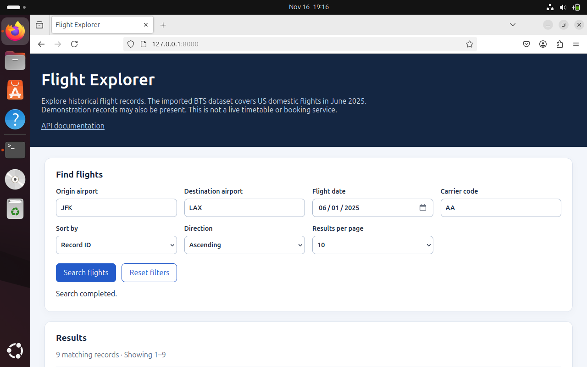
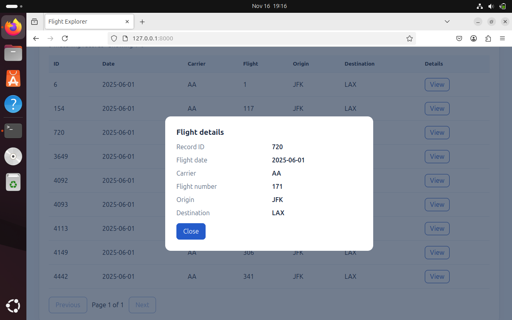

# Flight API Quality Lab

A flight exploration application and testing portfolio project built with Python, FastAPI and PostgreSQL.

The project combines a web interface, a REST API, historical flight data, automated tests and a containerized deployment workflow.

The application has been verified with 611,575 historical BTS records from June 2025. A fresh Docker installation starts with 25 fictional demonstration records.

This is an educational project, not a live flight tracker or booking service.

## Application Preview

### Flight Search



### Search Results


### Flight Details



## Features

- Browse flights through a web interface.
- Filter by origin, destination, date and carrier.
- Sort results and navigate between pages.
- View individual flight details.
- Create records through the REST API.
- Validate input with Pydantic and PostgreSQL constraints.
- Import historical BTS records from CSV.
- Skip matching records during repeated imports.
- Check API availability and database readiness.
- Automatically initialize a database and record migration history.
- Recognize the supported legacy schema without recreating its table.
- Add demonstration data only when the flights table is empty.
- Run API integration tests and Playwright browser tests.
- Verify Docker startup, repeatability and data persistence in CI.
- Publish a tested application image to GitHub Container Registry.

## Technologies

| Area | Technologies |
|---|---|
| Backend | Python 3.13, FastAPI, Pydantic |
| Database | PostgreSQL 17, Psycopg, SQL |
| Frontend | HTML, CSS, JavaScript |
| API testing | pytest, FastAPI TestClient |
| Browser testing | Playwright, pytest-playwright, Chromium |
| Manual testing | Postman |
| Containers | Docker, Docker Compose |
| Image registry | GitHub Container Registry |
| CI | GitHub Actions |
| Version control | Git, GitHub |

## Architecture

```text
Browser / Postman / HTTP client
              |
              | localhost:8000
              v
      FastAPI application
      + Flight Explorer UI
              |
              v
         PostgreSQL
              |
              v
      Persistent Docker volume
```

Docker Compose starts the services in this order:

```text
PostgreSQL becomes healthy
              |
              v
Bootstrap verifies/applies migrations
and optionally creates demo records
              |
              v
API and web interface start
```

The importer runs separately when requested.

The API, bootstrap process and importer use the same application image.
PostgreSQL runs in its own container.

## Quick Start: Published Docker Image

### Requirements

- Git
- Docker Engine or Docker Desktop
- A recent Docker Compose version supporting `!reset` and `--wait`
- Internet access to download container images

The published application image currently targets **Linux AMD64**.

Local Python and PostgreSQL installations are not required for this mode.

The commands below use a Linux shell. When using VirtualBox, run them inside Ubuntu and open the application in the VM's browser.

If your Docker installation requires elevated privileges, prefix Docker commands with `sudo`.

### 1. Download the configuration

```bash
git clone https://github.com/suchR3K/flight-api-quality-lab.git
cd flight-api-quality-lab
cp .env.example .env
```

Run subsequent commands from this directory.

### 2. Configure the environment

Edit `.env`:

```dotenv
POSTGRES_HOST=127.0.0.1
POSTGRES_PORT=5432
POSTGRES_DB=flight_lab
POSTGRES_USER=flight_app
POSTGRES_PASSWORD=replace_with_your_local_password
```

Choose a password before initializing PostgreSQL.

Do not commit `.env`. It is excluded from Git and the Docker build context.

For an existing installation, retain the working credentials.
Changing `.env` does not change an existing PostgreSQL user's password.

Optional settings:

```dotenv
API_PORT=8000
DB_PORT=5432
SEED_DEMO=true
IMAGE_TAG=latest
```

`DB_PORT` controls the database port exposed on the host.
Containers always connect to PostgreSQL at `db:5432`.

### 3. Start the application

```bash
docker compose -f compose.yaml -f compose.registry.yaml \
  up --no-build --pull always --wait --wait-timeout 180
```

This command:

1. Downloads the published application image and PostgreSQL.
2. Starts PostgreSQL and waits for its health check.
3. Runs the database bootstrap process.
4. Creates 25 fictional demo records if the flights table is empty.
5. Starts the API and web interface.

The first start requires image downloads and may take longer.

### 4. Open the application

- [Flight Explorer](http://127.0.0.1:8000/)
- [Interactive API documentation](http://127.0.0.1:8000/docs)
- [API health](http://127.0.0.1:8000/health)
- [Database readiness](http://127.0.0.1:8000/ready)

Check readiness:

```bash
curl -fsS http://127.0.0.1:8000/ready
```

Expected response:

```json
{"status":"ready","database":"ok"}
```

The `migrate` container finishing with `Exited (0)` is expected.
It is a one-time initialization task, not a continuously running service.

### Demonstration data

Demo records have flight numbers such as `DEMO001`.

They use:

- Origin: `JFK`
- Destination: `LAX`
- Flight date: `2025-06-01`
- Carrier code: `AA`

These records are fictional.

Set `SEED_DEMO=false` before startup to disable demo seeding.
Changing this setting does not remove existing records.

### Image tags

Published image:

```text
ghcr.io/suchr3k/flight-api-quality-lab:latest
```

The `latest` tag changes when another image is published.

Each publication also creates a commit-based tag:

```text
sha-<full-commit-hash>
```

To select a specific published build, set `IMAGE_TAG` in `.env` to its available commit-based tag.

For strict reproducibility, record the image digest shown by the registry.

## Historical BTS Dataset

Source: U.S. Bureau of Transportation Statistics,
[Reporting Carrier On-Time Performance](https://www.transtats.bts.gov/TableInfo.asp?QO_fu146_anzr=b0-gvzr&gnoyr_VQ=FGJ).

The dataset contains historical reports for domestic flights operated by reporting carriers.

The June 2025 dataset used during development produced:

| Metric | Result |
|---|---:|
| Imported historical records | 611,575 |
| First flight date | 2025-06-01 |
| Last flight date | 2025-06-30 |
| Distinct carrier codes | 14 |
| Rejected rows in the completed import | 0 |

These figures describe the verified development import.
Demo records and manually created flights may increase the total database row count.

The application does not download the dataset automatically.
Raw CSV files are excluded from Git and the Docker build context.

### Imported fields

| CSV column | Database field |
|---|---|
| `FL_DATE` | `flight_date` |
| `OP_UNIQUE_CARRIER` | `carrier_code` |
| `OP_CARRIER_FL_NUM` | `flight_number` |
| `ORIGIN` | `origin` |
| `DEST` | `destination` |

The importer currently does not store departure times, delays, cancellations or diversions, even if those columns are present in the CSV.

### Download and prepare the CSV

Use the [BTS download page](https://www.transtats.bts.gov/DL_SelectFields.aspx?QO_fu146_anzr=&gnoyr_VQ=FGJ) and select June 2025.

Include all five required columns listed above.

The current parser expects dates in this format:

```text
6/1/2025 12:00:00 AM
```

Create the local data directory:

```bash
mkdir -p data/raw
```

Save the extracted CSV as:

```text
data/raw/bts_flights_2025_06.csv
```

### Import through Docker

Import an initial sample:

```bash
docker compose -f compose.yaml -f compose.registry.yaml \
  run --rm importer /data/bts_flights_2025_06.csv --limit 1000
```

Import the complete file:

```bash
docker compose -f compose.yaml -f compose.registry.yaml \
  run --rm importer /data/bts_flights_2025_06.csv --limit 0
```

`--limit 0` means no row limit.

The local `data/raw` directory is mounted read-only at `/data` inside the importer container.

The importer prints:

- Target database
- Processed rows
- Inserted rows
- Skipped existing rows
- Rejected rows

Importing historical data does not remove existing demo or manually created records.

### Duplicate handling

The imported-record key consists of:

```text
flight_date + carrier_code + flight_number + origin + destination
```

A partial unique index applies when both flight date and carrier code are present.

The importer uses `ON CONFLICT ... DO NOTHING`.
Repeating an import skips matching records rather than creating duplicates.

Records without a date or carrier are outside this uniqueness rule.

Imported and manually created records do not currently have a dedicated source/provenance field.

## Database Bootstrap and Migrations

The bootstrap process is implemented in `bootstrap.py`.

Current migrations:

| File | Purpose |
|---|---|
| `001_create_flights.sql` | Create the flights table and basic constraints |
| `002_add_flight_details.sql` | Add flight date, carrier code and carrier validation |
| `003_add_flight_unique_index.sql` | Add duplicate protection for dated records |

### New databases

Bootstrap applies the migrations and records their names, checksums and timestamps in `schema_migrations`.

### Existing databases

For databases without migration history, bootstrap compares the flights table with reference structures generated from the supported SQL migrations.

If it recognizes a supported state, it registers the existing migrations and applies any remaining ones.

If the schema is unexpected, bootstrap stops rather than assuming it is compatible.

### Repeated startup

Bootstrap checks the recorded history and migration checksums.
Already applied migrations are not executed again.

Demo data is inserted only when enabled and the flights table is empty.

Schema changes, migration history and demo inserts are handled in one transaction.

### Limitations

This is a project-specific migration mechanism.

- The migration list is explicitly defined in `bootstrap.py`.
- New migration files require updating that list.
- Applied SQL files should not be edited.
- Unexpected schema changes, including additional indexes, may require investigation.
- The development database user needs permission to create the temporary reference schema.
- Production migration strategies and online schema changes are outside the project's current scope.

Back up an existing database before upgrading.

## API Endpoints

| Method | Path | Purpose |
|---|---|---|
| GET | `/` | Flight Explorer web interface |
| GET | `/health` | API availability |
| GET | `/ready` | Database connectivity and required flight columns |
| GET | `/flights` | Filtered, sorted and paginated records |
| GET | `/flights/{flight_id}` | Individual flight details |
| POST | `/flights` | Create a flight record |

### Search flights

```bash
curl "http://127.0.0.1:8000/flights?origin=JFK&destination=LAX&flight_date=2025-06-01&carrier_code=AA&limit=10&offset=0"
```

Supported query parameters:

| Parameter | Description |
|---|---|
| `origin` | Three-letter uppercase origin code |
| `destination` | Three-letter uppercase destination code |
| `flight_date` | Date in `YYYY-MM-DD` format |
| `carrier_code` | Carrier code |
| `limit` | Page size, from 1 to 100; default 20 |
| `offset` | Number of records to skip; default 0 |
| `sort_by` | `id`, `flight_date`, `carrier_code`, `flight_number`, `origin` or `destination` |
| `sort_order` | `asc` or `desc`; default `asc` |

The response contains:

```text
items
total
limit
offset
```

### Create a demonstration record

```bash
curl -X POST http://127.0.0.1:8000/flights \
  -H "Content-Type: application/json" \
  -d '{
    "flight_number": "EXAMPLE123",
    "origin": "WAW",
    "destination": "LHR",
    "flight_date": "2025-06-15",
    "carrier_code": "LO"
  }'
```

A successful request returns HTTP 201 and the created record.

Flight date and carrier code are optional.
Null date and carrier values are omitted from flight responses.

The database generates IDs. IDs are not guaranteed to be consecutive.

### Validation and errors

- Flight number, origin and destination are required.
- Flight numbers are trimmed and must not be blank.
- Airport codes must contain exactly three uppercase ASCII letters.
- Origin and destination must differ.
- A supplied carrier code must not be blank.
- Dates must be valid.
- Airport codes are validated for format, not against an airport directory.

| Status | Meaning |
|---|---|
| 201 | Flight created |
| 404 | Flight ID not found |
| 409 | Duplicate record covered by the unique index |
| 422 | Invalid request data |
| 503 | Database error handled by the application |

`/health` does not query PostgreSQL.

`/ready` checks database connectivity and the required flight columns.
It does not verify the complete migration history or every database constraint.

## Local Development

This mode builds the application image from source.

### Start the development stack

Configure `.env` as described in the quick start, then run:

```bash
docker compose up --build --wait --wait-timeout 180
```

Bootstrap runs automatically.
Do not manually apply the same migrations afterward.

### Rebuild after source changes

```bash
docker compose up -d --build
```

Application files are copied into the image.
Editing local source files does not automatically update a running container.

### Run the API directly in Python

Create a Python environment:

```bash
python3.13 -m venv .venv
source .venv/bin/activate
python -m pip install -r requirements.txt
```

After initializing the database through Compose, stop the API container to free port 8000:

```bash
docker compose stop api
python -m uvicorn main:app --reload
```

The local process uses `POSTGRES_HOST=127.0.0.1` from `.env`.
Containers use `POSTGRES_HOST=db`.

If using a non-default published database port, update the local Python connection settings accordingly.

### Run the importer directly in Python

```bash
source .venv/bin/activate
python import_bts.py data/raw/bts_flights_2025_06.csv --limit 1000
```

Local Python is optional for normal Docker-based use.

## Automated Tests

### API integration tests

API tests use the separate database `flight_lab_test`.

Create it once:

```bash
docker compose exec -T db \
  createdb -U flight_app flight_lab_test
```

Initialize its schema without demo data:

```bash
docker compose run --rm \
  -e POSTGRES_DB=flight_lab_test \
  -e SEED_DEMO=false \
  migrate
```

For the published-image setup, include both Compose files:

```bash
docker compose -f compose.yaml -f compose.registry.yaml \
  run --rm \
  -e POSTGRES_DB=flight_lab_test \
  -e SEED_DEMO=false \
  migrate
```

Run tests from the local Python environment:

```bash
source .venv/bin/activate
python -m pip install -r requirements.txt
mkdir -p reports
python -m pytest tests/ -v --junitxml=reports/api-junit.xml
```

PostgreSQL must be running.
A running Uvicorn process is not required because TestClient calls the application directly.

Coverage includes:

- Health responses
- Flight creation and retrieval
- Unknown IDs and invalid input
- Date and carrier validation
- Filtering and pagination
- Sorting and stable page ordering
- Duplicate detection
- Empty search results

### API test isolation

Before each test, the fixture:

1. Verifies that the connection uses `flight_lab_test`.
2. Prepares known flight records.
3. Overrides the API database dependency.
4. Rolls back the shared transaction after the test.

Tests must not explicitly commit the shared connection.

The fixture is designed for sequential execution.
Do not run these tests concurrently against the same test database.

### Browser tests

Install browser dependencies:

```bash
python -m pip install -r requirements-e2e.txt
python -m playwright install --with-deps chromium
```

With the application running on port 8000:

```bash
python -m pytest e2e/browser_checks.py -v \
  --browser chromium \
  --tracing=retain-on-failure \
  --screenshot=only-on-failure \
  --output=reports/playwright \
  --junitxml=reports/browser-junit.xml
```

Add `--headed` to watch the browser on a desktop Linux installation.

The four browser tests cover:

1. Search filters
2. Flight details
3. Empty search results
4. Pagination

These tests read the running application's data without inserting or deleting flights.

They expect:

- AA flights from JFK to LAX on 2025-06-01.
- At least 20 records for pagination.
- No records dated 2000-01-01.

Both the default demo dataset and the documented June 2025 import satisfy these requirements.

The browser tests are outside `tests/`, so they do not inherit the API database fixture.
Run `e2e/browser_checks.py` explicitly.

## GitHub Actions

### API and browser tests

Runs on pushes and pull requests.

The workflow:

1. Starts a temporary PostgreSQL database.
2. Installs Python and browser dependencies.
3. Creates the test schema.
4. Runs API integration tests.
5. Prepares deterministic browser test records.
6. Builds the API image.
7. Starts the container and waits for readiness.
8. Runs Chromium browser tests.
9. Uploads reports and application logs.

The `test-results` artifact can contain:

- API JUnit XML report
- Browser JUnit XML report
- API container logs
- Browser failure screenshots and traces

Artifacts are retained for 14 days.

### Docker bootstrap tests

Runs on pushes and pull requests.

It verifies:

- Startup with an empty database
- Creation of 25 demo records
- Registration of three migrations
- Repeated bootstrap without data changes
- Data preservation after recreating containers
- Recognition of a legacy database without migration history
- Preservation of legacy records without adding demo data

Logs are uploaded as `docker-bootstrap-results`.

### Publish Docker image

Runs manually from the `main` branch.

Before publication, it:

1. Builds and starts the Compose application.
2. Checks readiness, demo data and the web page.
3. Publishes the tested image to GHCR.

Published tags:

```text
latest
sha-<full-commit-hash>
```

Authentication uses GitHub Actions' `GITHUB_TOKEN`.

The publishing workflow performs smoke checks.
It does not automatically enforce successful results from the other workflows.
Run it only after the API, browser and bootstrap workflows have passed for the commit being published.

## Docker Operations

For the published-image setup, consistently use both Compose files.

### Check service status

```bash
docker compose -f compose.yaml -f compose.registry.yaml ps -a
```

### View logs

```bash
docker compose -f compose.yaml -f compose.registry.yaml \
  logs --tail=80 api migrate db
```

### Stop services

```bash
docker compose -f compose.yaml -f compose.registry.yaml stop
```

### Start again

```bash
docker compose -f compose.yaml -f compose.registry.yaml \
  up --no-build --wait --wait-timeout 180
```

### Download and start an updated image

Back up an existing database before upgrading.

```bash
docker compose -f compose.yaml -f compose.registry.yaml \
  up --no-build --pull always --wait --wait-timeout 180
```

### Data persistence

PostgreSQL stores data in the named `postgres_data` volume managed by Compose.

Keep the same Compose project name when reusing an existing database.
A different project name normally creates a separate volume.

Stopping or recreating containers does not delete the named volume.

`docker compose down -v` deletes the project's volumes and database data.

### Container settings

- The application runs as a non-root user with UID 10001.
- Database credentials are provided through environment variables.
- `.env` is not copied into the application image.
- API and database ports are bound to localhost.
- The importer mounts the raw-data directory read-only.

This configuration is intended for local use.
It does not publish the website to the public internet.

## Database Backup

Create a backup directory outside the repository:

```bash
mkdir -p ~/backups/flight-api
```

Export the application database:

```bash
backup_file="$HOME/backups/flight-api/flight_lab_$(date +%Y%m%d_%H%M%S).dump"

docker compose -f compose.yaml -f compose.registry.yaml \
  exec -T db pg_dump -U flight_app -d flight_lab -Fc > "$backup_file"
```

Check the exit status immediately:

```bash
echo $?
```

A successful command returns `0`.

Check that the archive's table of contents can be read:

```bash
docker compose -f compose.yaml -f compose.registry.yaml \
  exec -T db pg_restore --list < "$backup_file"
```

Reading the archive is not a substitute for testing a restore into a separate database.

## Manual Testing and Project History

Postman collection:

```text
postman/flight-api.postman_collection.json
```

Set its `base_url` variable to:

```text
http://127.0.0.1:8000
```

The original collection contains fixed record IDs and baseline assumptions.
Review its requests and assertions before using it with imported data.
An ID previously treated as nonexistent may now exist.

Postman requests that create records modify the application database.
The collection is not run by the current CI workflows.

Additional documentation:

- [Manual test cases](docs/test-cases.md)
- [Manual test results](docs/manual-test-results.md)
- [Port 8000 conflict investigation](docs/troubleshooting/port-8000-conflict.md)
- [Original fresh-clone verification](docs/fresh-clone-verification.md)

These documents record earlier verification work and are not automatically updated by CI.

The original fresh-clone report covers the earlier 30-test version, not the complete current application.

## Troubleshooting

### Port 8000 or 5432 is already in use

Inspect listening processes:

```bash
sudo ss -ltnp 'sport = :8000'
sudo ss -ltnp 'sport = :5432'
```

Stop a conflicting local service or choose different `API_PORT` and `DB_PORT` values in `.env`.

### Image download fails

Verify that:

- The image publication workflow completed successfully.
- The GHCR package is public for anonymous access.
- The selected `IMAGE_TAG` exists.
- The image name uses lowercase characters.

```bash
docker pull ghcr.io/suchr3k/flight-api-quality-lab:latest
```

### Compose does not recognize `!reset` or `--wait`

Check the installed version:

```bash
docker compose version
```

Update Docker Compose to a recent version.

### Migration container reports `Exited (0)`

This is normal.
Bootstrap completed successfully and the container exited.

A nonzero exit code requires investigation.

### Bootstrap rejects the existing schema

Inspect migration logs:

```bash
docker compose -f compose.yaml -f compose.registry.yaml \
  logs --tail=100 migrate
```

Do not delete the database volume or manually mark migrations as applied to bypass the error.

Check for modified migration files, unsupported schema changes or an incorrect target database.

### Database credentials do not work

Verify that `.env` matches the credentials used when the PostgreSQL volume was initialized.

Changing environment variables does not update existing database users.

### Browser tests fail

Check application readiness and the test-data prerequisites.

Inspect the failure screenshots and traces under:

```text
reports/playwright/
```

### Importer cannot find the CSV

Verify the host file exists:

```bash
ls -lh data/raw/bts_flights_2025_06.csv
```

Inside the importer container, use:

```text
/data/bts_flights_2025_06.csv
```

## Current Limitations

- No authentication or authorization.
- No live flight status, booking or airline integration.
- No update or deletion endpoints.
- No delay, cancellation or departure-time analysis.
- No automated BTS dataset download.
- No dedicated record provenance field.
- No database connection pooling.
- Project-specific migration handling rather than a general migration framework.
- The development database uses a privileged bootstrap user.
- The application image includes API test dependencies.
- API tests require sequential execution.
- Published images currently target Linux AMD64.
- No load-testing results or production performance guarantees.
- No public hosting, HTTPS configuration or production deployment setup.


